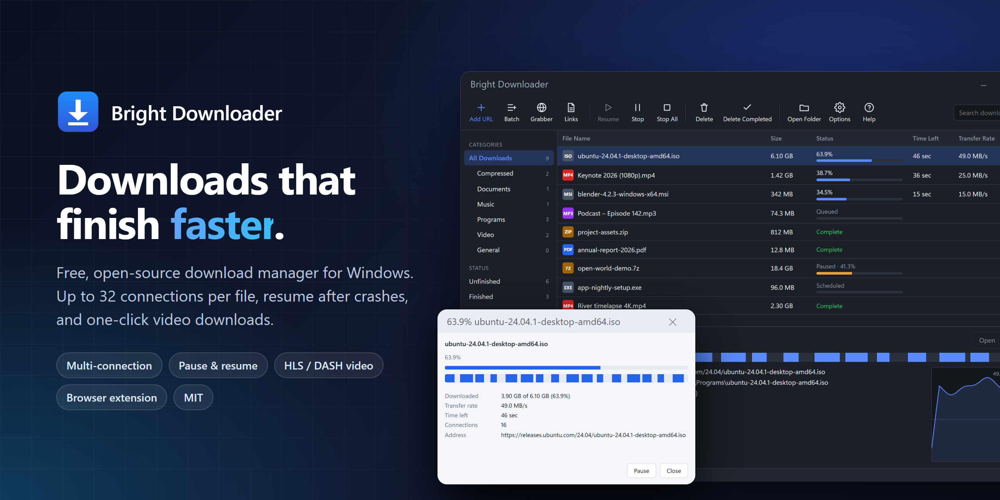
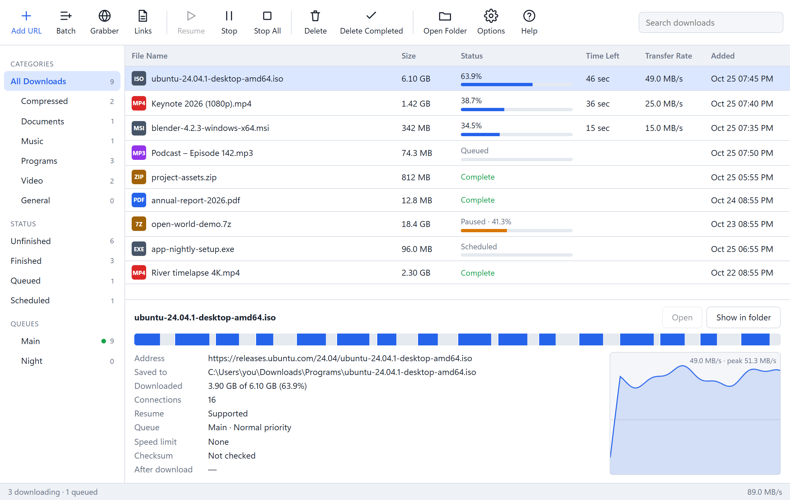
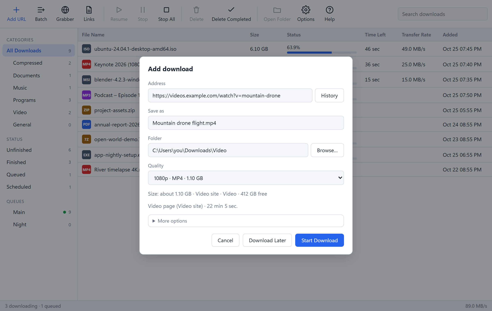
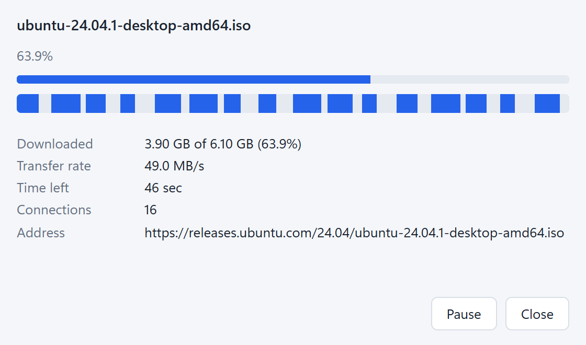

<p align="center">
  
</p>

<p align="center">
  <a href="https://github.com/Suleiman700/bright-downloader/releases/latest"><b>Download</b></a> ·
  <a href="https://suleiman700.github.io/bright-downloader/"><b>Website</b></a> ·
  <a href="https://github.com/Suleiman700/bright-downloader/issues">Report a problem</a> ·
  by BrightPixel
</p>

# Bright Downloader

**Bright Downloader** is a fast, free and open-source download manager for
Windows. It splits each file across up to 32 connections and keeps every one of
them busy until the last byte, so big downloads finish sooner. Pause any time
and pick up where you left off, even after a crash or a reboot.

It also catches downloads and videos straight from your browser, saves streams
and videos from 1,000+ sites in the quality you choose, and handles the
routine work for you: queues, a scheduler, speed limits, checksums and
automatic retries. No ads, no account, no tracking.

## Screenshots

<picture>
  <source media="(prefers-color-scheme: dark)" srcset="site/images/main-dark.png" />
  
</picture>

<table>
  <tr>
    <td width="62%"></td>
    <td></td>
  </tr>
  <tr>
    <td>Video pages and HLS / DASH streams: pick the quality before downloading.</td>
    <td>Progress window: each block is one connection's share of the file.</td>
  </tr>
</table>

## Features

- **Multi-connection downloads.** The file is split across up to 32
  connections using HTTP range requests, or FTP `REST` for `ftp://` links
  (plain FTP; user and password in the address or saved in Options → Logins).
- **Dynamic segmentation.** When a connection finishes its part it takes over
  half of the largest remaining part, so slow connections never hold up the end
  of a download.
- **Pause & resume**, including after a crash or reboot. Progress is saved
  next to the file, and the server's ETag / Last-Modified is checked on resume so
  a changed file is never stitched together with old data.
- **Automatic retries** with back-off on dropped connections. Permanent errors
  (404, 403, …) stop immediately. A download that still fails because of the
  network restarts on its own a few more times (configurable).
- **Checksums**: paste an MD5 or SHA-256 when adding a file and it is verified
  when the download finishes; *Verify checksum…* checks any finished file.
- **Free-space check** before a download starts; the full size is reserved on
  disk up front.
- **Queues**: as many as you like, each with its own "at once" limit, plus
  High / Normal / Low priority per download. Right-click a queue in the
  sidebar to start or stop it.
- **Speed limiter**: an overall limit plus an optional limit per download
  (right-click → *Speed limit…*), both adjustable while downloading.
- **Connections per server**: override the connection count for specific
  hosts (Options → Connection).
- **Proxy**: use Windows' proxy settings, no proxy, or a specific HTTP(S) /
  SOCKS5 proxy.
- **Saved logins** for servers that ask for a user name and password (HTTP
  Basic and FTP). Passwords are encrypted for your Windows account (DPAPI).
- **Download limit**: at most so many MB per period; downloads stop when it
  is reached and continue when the period ends.
- **Keep in sync**: re-check a finished file every hour / day / week and
  download it again when the server copy changes.
- **Expired links**: right-click → *Get a new address from the browser*
  opens the download's page; start the download again there and the
  extension hands the fresh address to the waiting download, which continues.
- **Categories**: files are sorted into Compressed / Documents / Music /
  Programs / Video / General, each with its own folder.
- **Scheduler**: "Download Later" items start and stop at set times on
  chosen weekdays.
- **When all downloads finish**: quit, sleep, hibernate, shut down (each with
  a 30-second countdown you can cancel) or run a program.
- **Batch and link lists**: numbered ranges like `photo[001-100].jpg` or
  `[a-z]`, pasted lists of links, and import / export of `.txt` link lists.
  Dropping links, text or a `.txt` file on the window, or pressing Ctrl+V on
  the list, adds them too.
- **Site grabber**: lists the files linked from a web page (optionally
  following links a few levels deep on the same site) so you can pick which to
  download.
- **After download**: optional virus scan (Microsoft Defender or any scanner
  command), extraction of zip / 7z / rar / tar archives, and opening the file
  or its folder.
- **Duplicate warning** when a link is already in the list.
- **Clipboard monitor**: copy a link to a file anywhere and Bright Downloader offers
  to download it.
- **Speed graph** and per-connection progress bar for the selected download.
- **Video streams**: HLS (`.m3u8`) and MPEG-DASH (`.mpd`). Pick the quality;
  segments download over several connections with resume, AES-128 encrypted
  HLS included. Live streams are recorded until you press Stop, then saved.
  With [ffmpeg](https://ffmpeg.org) streams are saved as `.mp4` with
  separate audio merged; without it HLS is saved as `.ts`.
- **Video sites** (YouTube and the 1,000+ sites [yt-dlp](https://github.com/yt-dlp/yt-dlp)
  supports): paste the page address and choose a quality.
- **One-click helpers**: Options → Video downloads ffmpeg and yt-dlp from
  their official GitHub releases, checks them against the published SHA-256
  sums and installs them into Bright Downloader's own folder. Programs already on the
  PATH are used too.
- DRM-protected video (Netflix-style: Widevine, PlayReady, FairPlay,
  SAMPLE-AES) cannot be downloaded.
- **Progress window** per download (double-click a running download, or turn
  it on for every download in Options → General).
- **Languages**: English, Arabic (right-to-left), French and Spanish
  (Options → General → Language; "Same as Windows" by default). Error
  messages that come from servers or helper programs stay in English.
- **Start with Windows** (to the tray), light / dark / system theme.
- **Change address.** If a link expires, right-click → *Change address…* and
  paste a fresh one. The download continues where it stopped as long as the
  file on the server is the same.
- **Runs in the system tray.** Closing the window keeps Bright Downloader running so
  browser capture and the scheduler keep working. Quit from the tray menu,
  which saves progress first. A Windows notification appears when a download
  finishes or fails.
- **Browser integration** (Chrome / Edge): downloads are captured and handed
  to Bright Downloader together with the page's cookies, referrer and user agent, so
  downloads behind a login work. There is also a right-click
  *Download with Bright Downloader* menu entry.
- **Video detection in the browser**: the extension notices videos, HLS and
  DASH streams a page plays and shows a *Download this video* button on the
  video, with a choice of quality. For players that hide their
  streams (YouTube and similar) it offers *From this page*, which goes
  through yt-dlp. The toolbar badge counts what was found and the popup
  lists it. The extension is translated into the same four languages.

## Project layout

| Path | What |
|---|---|
| `crates/engine` | Download engine (Rust library): probing, segment table, workers, resume, rate limiting, HLS, checksums |
| `src-tauri` | Desktop app backend: download manager, queues, scheduler, browser bridge, site grabber, post-download steps |
| `src` + `index.html` | App UI (TypeScript, no framework) |
| `extension` | Browser extension (Manifest V3) |

## Building

Requirements: [Rust](https://rustup.rs), Node.js 20+, pnpm, and the
Microsoft C++ Build Tools (WebView2 ships with Windows 10/11).

```sh
pnpm install
pnpm tauri dev      # run in development mode
pnpm tauri build    # produce installers in target/release/bundle/
```

Run the tests:

```sh
cargo test --workspace
```

## Command line

```text
brightdl.exe <url> [--dir <folder>] [--name <file>] [--queue <name>] [--later] [--silent]
```

Without `--silent` the Add dialog opens with the link filled in; with it the
download is added straight away (`--later` adds it without starting). The
short switches `/d <url> /p <folder> /f <file> /a /n` work too. If Bright Downloader is
already running, the link goes to the running instance.

## Installing the browser extension

**Chrome / Edge**

1. Open `chrome://extensions` (or `edge://extensions`).
2. Turn on **Developer mode**.
3. Click **Load unpacked** and choose the `extension` folder.

**Firefox** (128 or newer)

1. Open `about:debugging#/runtime/this-firefox`.
2. Click **Load Temporary Add-on…** and choose `extension/manifest.json`.
3. In `about:addons` → Bright Downloader Integration → Permissions, allow access to
   all websites (Firefox asks for host access separately).

While Bright Downloader is running, matching downloads are sent to it automatically.
If the app is closed, the browser downloads normally. Click the extension icon
to choose which file types to capture, to turn the video button off, or to
see the videos found on the current page.

After updating the extension files, click the reload icon on its card in
`chrome://extensions`.

The app listens on `127.0.0.1:47809` and only accepts requests that come
from a browser extension. Web pages cannot send downloads to it.

## License

MIT. See [LICENSE](LICENSE).

## Updates

*Help → Check for updates* (and an automatic check at startup and twice a day,
which can be turned off in Options → General) looks at the latest published
release on GitHub. An update is only offered when the release has a Windows
installer and a checksum for it: the SHA-256 GitHub computed for the uploaded
file, the one in the release's `SHA256SUMS.txt`, or both (they must agree).
After downloading, the installer is hashed again and only run if it matches.
Bright Downloader then closes, the installer runs with only a progress bar,
the new version starts, shows the release notes and resumes the downloads that
were running.

## Releasing a new version

1. Set the new `version` in the root `Cargo.toml` (for example `0.2.0`). The
   app reads its version from there.
2. Write what's new in `RELEASE_NOTES.md`. Installed copies show this text in
   the update popup and again after updating.
3. Commit, then tag and push: `git tag v0.2.0 && git push origin main v0.2.0`.
4. The *Release* workflow builds the installer and creates a **draft**
   release with `Bright-Downloader_0.2.0_x64-setup.exe` and `SHA256SUMS.txt`.
5. Check the draft on GitHub and press **Publish release**. Users are offered
   the update from then on.

The website in `site/` is published by the *Website* workflow. Enable it once
in the repository's Settings → Pages → Source: **GitHub Actions**.

